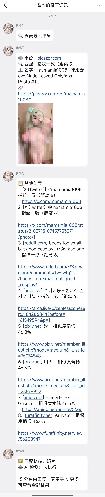

# 麦麦寻人（com.fsqhn.image-searcher）

把群里的图片反查原始出处与社交账号：多引擎以图搜图 → 图片指纹验证是不是同一张图 → 输出「平台 / 匹配方式 / 名字 / 账号」。

主要面向真人 coser 图的找原作者与 X 账号，不依赖人脸识别，图里没露脸也能用。

> **本插件由 AI 编写。** 已经在作者自己的 MaiBot 上跑通并做了有限的实际验证，但**不保证在你那边的 MaiBot、适配器、网络环境下表现一致**。遇到问题请看[详细日志与反馈](#详细日志与反馈)。

## 实际效果

群里只发指令、没带图，它会提示补图并等 60 秒：


60 秒内补一张单图，它回一句「收到图片，开始搜图」，约 40 秒后发出一条合并转发。点开就是结果：



这就是典型产出：最佳匹配给出平台（picazor.com）、指纹距离 5（判定为同一张图）、名字和账号，并附上原图；下面依次是其他结果——X 上的同一个账号、Reddit 的原帖、arca.live、pixiv 上相似度不够的近似图，每条都标了「指纹一致」还是「相似度偏低」，末尾再给匹配路线和「回复更多」的提示。**能定位到账号的才给账号，指纹不符的只会留在参考区。**

## 模型也能直接调用

除了指令，插件还向 LLM 暴露了两个工具，planner 自己就能决定调它们：

| 工具 | 作用 | 参数 |
|---|---|---|
| `image_search` | 取当前会话最近一张图（或用户引用的图）开始搜，立刻返回 `task_id`，不等结果 | `note`（可选备注） |
| `search_status` | 凭 `task_id` 查进度或结果；不传就取本会话最近一次任务 | `task_id`（可选） |

典型流程是：用户发图说「这谁啊」→ planner 调 `image_search` 拿到 `task_id` → 回一句「正在搜，约 40 秒」→ 40 秒后再调 `search_status` 取文字摘要。工具**只返回文字**（平台、名字、账号、链接、AI 检测结论），不会把图片塞给模型，所以不占上下文。

有两点要知道：

- MaiBot 的工具是**延迟暴露**的，planner 第一轮通常只完成 `tool_search` 发现插件，**第二次触发才真正调用**。这是宿主机制，不是插件没装上。
- 指令触发和模型调用是两条并行入口，同一张图谁先来算谁。指令会直接发合并转发，模型调用只给文字摘要。

## 它长什么样

搜完会在群里发一条合并转发，四个节点：

```
🔍 麦麦寻人结果
├─ 最佳匹配
│    🌐 平台：X（Twitter）
│    🔍 匹配：图片指纹一致（距离 2）
│    👤 名字：荣小兔头
│    🆔 账号：@usagi_rr
│    [配图]
├─ 参考结果
│    1. [Lens] Instagram · 某某 · @xxx ｜ 未验证
│    2. [Yandex] 微博 · 某某 ｜ 指纹不符（距离 31）
│    ...
└─ 🖼 匹配路线：照片
   🤖 AI 检测：未执行
   15 分钟内回复「麦麦寻人 更多」可查看全部结果
```

模型（planner）那一侧只拿到纯文字摘要，不带图，不阻塞对话。

## 功能

- **四个引擎**：Google Lens（SerpAPI）、Yandex、百度、SauceNAO。每个都能单独开关、调优先级、调每次取几条。
- **多 key 轮询**：同一个引擎可以配多个 key，遇到 401/403/429 自动冷却并换下一个。
- **指纹验证**：候选图下载后与本图做 dHash 比对。距离 ≤ `hash_threshold` 才判「同一张图」，只有通过验证的结果会给账号；距离偏大的标「疑似」，没下到图的标「未验证」。
- **同距离优先 X**：多个候选的指纹距离完全相同时，优先采用 X（Twitter）那条作为最佳匹配，找账号更直接。
- **双路线**：默认照片顺序 Lens → Yandex → 百度 → SauceNAO；SauceNAO 相似度达到 `route_similarity` 时判定为插画，自动切到 SauceNAO → Yandex → 百度 → Lens。不猜输入图的画风，靠插画库命中反推。
- **异步任务**：模型侧调用工具立刻拿到 `task_id`，约 40 秒后再取结果。
- **可追问**：结果保留 15 分钟，回复「更多」重发完整列表，不重新搜。
- **AI 图检测**（可选）：没有可靠匹配时才调 Sightengine，省额度。

## 安装

1. 把整个目录放到 MaiBot 的 `plugins/com.fsqhn.image-searcher/`。
2. 依赖只有 `Pillow` 和 `requests`，一般已随 MaiBot 装好；缺的话 `pip install Pillow requests`。
3. **先填代理**（`[plugin] proxy`，或者 WebUI 里的「基础设置 → 代理地址」）。不填代理，Lens 和 Yandex 基本都搜不出来，看图下载也会大量失败。
4. 在插件管理里启用，然后重载插件。
5. 群里发一张图，发送 `麦麦寻人`。

首次加载会自动生成 `config.toml`，可以对照 `config.example.toml` 手改，也可以直接在 WebUI 里改。

## 申请 API / 密钥

四个引擎里 Yandex 和百度不需要 key，另外三个需要自己申请。**都填在 `config.toml` 里，不要提交到仓库。**

### Google Lens（SerpAPI）

1. 打开 https://serpapi.com/users/sign_up 注册（支持 GitHub / Google 登录）。
2. 登录后进 Dashboard，`Your Private API Key` 那一串就是 key。
3. 免费额度：**250 次/月、50 次/小时**。注意额度按「调用次数」算，跟返回几条结果无关，把 `max_results` 调小并不能省额度。
4. 填到：

```toml
[lens]
enabled = true
keys = ["你的 SerpAPI key"]
```

国内直连 `serpapi.com` 基本不通，**必须先配好代理**（见下面[代理](#代理很重要建议先配好)）。

### SauceNAO

1. 打开 https://saucenao.com/user.php 注册账号。
2. 登录后进 https://saucenao.com/user.php?page=search-api ，页面上会显示你的 API Key。
3. 免费档限制：每天 100 次、30 秒 4 次，单次最多返回 4 条（`short_limit`）。**匿名 API 已关闭，没 key 时插件会跳过这个引擎**。
4. 填到：

```toml
[saucenao]
enabled = true
keys = ["你的 SauceNAO key"]
```

SauceNAO 索引的是 pixiv、danbooru 这类插画站，真人照片常常没结果。这里它还有个额外作用：**它的高相似度命中被用来判断「这张是不是插画」**，从而决定走哪条引擎顺序。

### Sightengine（可选，AI 生成图检测）

1. 打开 https://dashboard.sightengine.com/signup 注册。
2. 进 Dashboard 的 API keys，能拿到 `api_user` 和 `api_secret` 两个值。
3. 填成 `api_user:api_secret` 的格式：

```toml
[ai_detect]
enabled = true
keys = ["123456:abcdefg..."]
```

免费额度 2000 ops/月，单次 `genai` 检测计 5 ops，大约 400 次/月。插件只在「没有可靠匹配」时才调用它，所以正常用不会很快耗尽。

### Yandex 与百度

都不需要 key。

- **Yandex**：不需要 key，但国内直连经常超时或被拒，**必须配代理**。
- **百度**：直连一般可用。它返回的是裁剪过的缩略图，指纹距离常在 10~14，所以百度结果多数只能到「疑似」。

## 代理（很重要，建议先配好）

**没配代理，这个插件基本用不了。** 原因很直接：

- Google Lens 走 `serpapi.com`，国内直连基本不通，搜图请求会直接失败；
- Yandex 国内直连经常超时或被拒，你会看到「Yandex 未返回结果」；
- 候选图大多在 `pbs.twimg.com`、`cdninstagram.com`、`avatars.mds.yandex.net` 这些境外域名上，下载不下来就只能标「未验证」，等于白搜。

所以**装完第一件事就是填代理**，而不是等出问题再填。

全插件只有**一个**代理设置，引擎、候选图下载、AI 检测全都走它：

```toml
[plugin]
proxy = "http://127.0.0.1:6789"
```

在 WebUI 里就是「基础设置 → 代理地址」这一项，填完保存即可。

写 `direct`（也认 `none`、`off`）表示强制直连，只在你本身就有全局透明代理或海外线路时才这么填。留空等于直连。

只支持 HTTP/HTTPS 代理（`http://127.0.0.1:6789` 这种）。要用 `socks5://` 得先 `pip install pysocks`，插件本身只声明了 `requests`。

如果代理只支持 HTTP、不认 HTTPS 隧道，或者经常掉线，先在服务器上用 `curl -x http://127.0.0.1:6789 https://serpapi.com/ -I` 确认能通，再回来搜图。

## 配置项

| 项 | 默认 | 说明 |
|---|---|---|
| `enabled` | true | 插件总开关 |
| `command` | `麦麦寻人` | 触发指令，**改后必须重载插件** |
| `aliases` | [] | 指令别名，同样要重载 |
| `nickname` | 麦麦寻人 | 合并转发里显示的昵称 |
| `verbose_log` | false | **详细日志开关**，排查问题时打开 |
| `task_ttl_minutes` | 15 | 结果保留时间，期间可追问 |
| `show_reference` | true | 是否展示参考区 |
| `reference_limit` | 8 | 首次回复参考区条数 |
| `more_limit` | 20 | 追问「更多」时参考区条数 |
| `verify_top_n` | 3 | Yandex / 百度各验证前 N 条，Lens 取 2N 条 |
| `image_wait_seconds` | 60 | 只发指令没带图时，等补图的秒数 |
| `hash_threshold` | 8 | 汉明距离 ≤ 该值判为同一张图，越小越严格 |
| `engine_timeout` | 35 | 单引擎超时（秒） |
| `download_timeout` | 12 | 下载候选图超时（秒） |
| `proxy` | 空 | 唯一的代理设置，所有引擎、图片下载、AI 检测都走它；留空即直连，**强烈建议填写** |
| `max_concurrent_tasks` | 3 | 同时进行的搜索数上限 |

四个引擎各自独立成段：`[lens]`、`[yandex]`、`[baidu]`、`[saucenao]`，每段都有 `enabled` / `keys` / `max_results`，`[saucenao]` 额外有 `min_similarity` 和 `route_similarity`。引擎段里没有单独的代理，统一用上面那一个。
**代理是必填项**，不填基本搜不出东西，别跳过这一步。

`keys` 是数组，可以填多个 key 轮询：哪个被限流或失效就自动跳下一个，另一个 key 继续用。WebUI 里对应「API Key」那一栏，点添加即可再加一个。

`priority` 决定展示与判定顺序，`priority_drawn` 是插画路线的顺序。这两项就是**优先级设置**：数组顺序即优先级，越靠前越优先采用、越靠前展示，把引擎名往前挪就是提高它的优先级。

## 怎么触发

| 写法 | 作用 |
|---|---|
| 图 + `麦麦寻人`（同一条消息） | 直接搜这张图 |
| `麦麦寻人` + 图（下一条消息） | 先提示发图，60 秒内补一张单图就自动开始搜 |
| 引用一条带图消息 + `麦麦寻人` | 搜被引用的那张图 |
| 只发 `麦麦寻人`（不带图也不引用） | 提示发图或引用，进入 60 秒等待；超时会回复提示超时 |
| `麦麦寻人 更多` / 单独发 `更多` | 重发上次结果，参考区展开到 `more_limit` 条 |
| `麦麦寻人 状态` | 查看本会话最近一次任务状态 |

补充说明：

- 指令前可以带图片占位符，`[image] 麦麦寻人` 这种也能识别。
- 群消息必须 @ 到机器人或被指令识别到才会触发，具体取决于你的适配器与机器人配置。
- 等待窗口按「会话 + 用户」配对，群里几个人同时等图不会串。

## 输出里各个状态是什么意思

| 状态 | 含义 | 该不该信 |
|---|---|---|
| 图片指纹一致（距离 ≤ 8） | 候选图和你发的图基本是同一张 | 可以信，账号通常就是原作者 |
| 疑似（距离 9~20） | 高度相似但可能有裁剪、压缩、二次编辑 | 当线索，别当结论 |
| 指纹不符 | 搜出来的是同题材的另一张图 | 忽略 |
| 未验证 | 候选图下载失败或不是图片（常见 403、防盗链） | 只能点链接自己看 |

找不到可靠匹配时，插件会如实说「没找到」，并在参考区列出所有候选，同时附一张相似度最高的参考图方便你对照；如果开了 AI 检测且置信度高，会提示可能是 AI 生成图。

## 详细日志与反馈

默认只打关键日志。排查问题时：

1. 把 `config.toml` 里的 `verbose_log` 改成 `true`，重载插件。
2. 复现问题。
3. 从 MaiBot 的 `logs/app_*.log.jsonl` 里筛出 `plugin.com.fsqhn.image-searcher` 的行。

开启后会多出这些记录：取图来源与体积、各引擎返回条数与错误、候选的指纹验证分布、走了哪条路线、最终最佳匹配是谁。

**提 issue 时请把这段日志一起贴上**，只说「搜不出来」基本没法定位。也欢迎在仓库 Issues 里直接提想法和改法，包括你觉得该加哪个引擎、展示顺序怎么排更顺手。

## 已知限制

- 只认「同一张图」。被裁过、拼成九宫格、加了重滤镜的图多半只能到「疑似」。
- 部分 CDN 会封服务器 IP（例如 `cdn.donmai.us` 直接返 403，Instagram 的 SEO 缩略图地址返回的不是图片），这类候选只能标「未验证」。
- Yandex 依赖代理，代理抖动会导致这个引擎超时；插件会重试一次，但连续失败时就只有三个引擎在跑。
- 各引擎返回条数、反爬策略随时可能变。引擎结果页结构变了会报「结果页结构变化」。
- Lens 额度按调用次数计，搜得勤会先把 250 次/月用完。
- 只在作者自己的环境（MaiBot + SnowLuma / NapCat 适配器）验证过，其他适配器下取图链路可能需要调整。

## 目录

```
plugin.py            生命周期、Tool、Command、Hook、取图与编排
core/engines.py      四个引擎 + AI 检测 + 指纹验证
core/hashing.py      dHash 与上传前压缩
core/keypool.py      多 key 轮询与冷却
core/extract.py      平台识别、账号提取
core/formatting.py   合并转发与纯文字摘要
core/tasks.py        任务表（内存 + 摘要落盘）
core/httpclient.py   会话与图片下载
core/commands.py     指令正则构建
core/maibot_compat.py 能力返回值解包
AGENTS.md            给后续接手代码的 AI/开发者的边界与踩坑清单
```

## 测试

```bash
python -m unittest discover -s tests -v
```

目前 38 项，覆盖 dHash 对缩放 / JPEG 重压 / 裁剪的距离、账号与平台提取、指令正则（含前置图片占位符）、能力返回值解包。

## 声明

- **本插件由 AI 编写**（PAI + DeepSeek-Flash），作者做的是提需求、跑验证和修问题。
- 只在作者的 MaiBot 环境做过**有限的可用验证**，不保证其他版本、其他适配器、其他网络环境下同样可用。
- 检索结果版权归原作者，插件只用于找原作者与出处，请勿用于未授权转载。
- 各引擎的使用需遵守其服务条款；SerpAPI、SauceNAO、Sightengine 都需要自己申请账号。
- 许可证：MIT，见 [LICENSE](LICENSE)。

## 关于 PAI

本插件是用 [PAI](https://github.com/kawayiYokami/P-ai/) 配合 DeepSeek-Flash 写出来的：提需求、看日志、定位问题、改代码、部署验证，都在同一个对话里完成。

PAI 是一个开箱即用的自我成长型桌面 AI 助理，面向长期任务、记忆、部门协作、工具审查、MCP 与工作区自动化，数据存在本地。如果你也想给自己的机器人写插件，这种「能读你的项目、连你的服务器、按你的口径改」的协作方式，比让模型直接吐一段代码靠谱得多。
