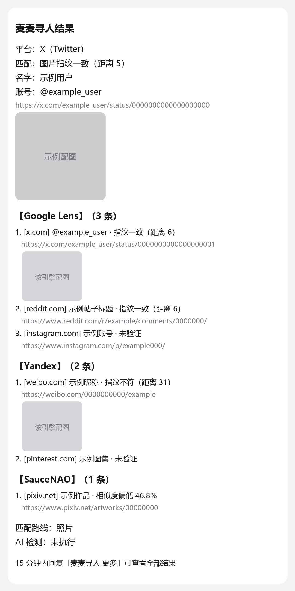

# 麦麦寻人（com.fsqhn.image-searcher）

把群里的图片反查原始出处与社交账号：多引擎以图搜图 → 图片指纹验证是不是同一张图 → 输出「平台 / 匹配方式 / 名字 / 账号」。

也可以叫「麦麦找鸡」——本质一样，都是按图找出处、找人。

主要面向真人 coser 图的找原作者与 X 账号，不依赖人脸识别，图里没露脸也能用。

> **本插件由 AI 编写。** 已经在作者自己的 MaiBot 上跑通并做了有限的实际验证，但**不保证在你那边的 MaiBot、适配器、网络环境下表现一致**。遇到问题请看[详细日志与反馈](#详细日志与反馈)。

## 实际效果

群里只发指令、没带图，它会提示补图并等 60 秒：


60 秒内补一张单图，它回一句「收到图片，开始搜图」，约 1 分钟后发出一条合并转发。点开就是结果：



搜到结果时，首次回复只给结论：平台、指纹距离、名字、账号、链接和一张配图，想看别的候选回「更多」。没找到时才会把参考区一起发出来，**按引擎分组**，先给该引擎最接近的一条并配上它的图，其余候选只列文字。（第二张图是结构示意，字段与配图均为虚构示例。）

## 模型也能直接调用

除了指令，插件还向 LLM 暴露了两个工具，planner 自己就能决定调它们：

| 工具 | 作用 | 参数 |
|---|---|---|
| `image_search` | 对指定的图开始搜，立刻返回 `task_id`，不等结果 | `msg_id`（带图消息 ID，可搜旧图）、`note`（备注）、`force`（忽略缓存重搜） |
| `search_status` | 凭 `task_id` 查进度或结果；不传就取本会话最近一次任务 | `task_id`（可选） |

典型流程是：用户发图说「这谁啊」→ planner 调 `image_search` 拿到 `task_id` → 回一句「正在搜，约 1 分钟」→ 再调 `search_status` 取文字摘要。工具**只返回文字**（平台、名字、账号、链接、AI 检测结论），不会把图片塞给模型，所以不占上下文。用户说「重搜」「再查一遍」时，模型把 `force` 设成 `true` 就会跳过按图缓存。

有两点要知道：

- MaiBot 的工具是**延迟暴露**的，planner 第一轮通常只完成 `tool_search` 发现插件，**第二次触发才真正调用**。这是宿主机制，不是插件没装上。
- 指令触发和模型调用是两条并行入口，同一张图谁先来算谁。指令会直接发合并转发，模型调用只给文字摘要。

**指定图片有三种方式，模型能自己挑。** 上下文里每条消息都带 `<message msg_id="...">`，模型把那条消息的 `msg_id` 填进 `image_search`，插件就按 ID 取图，**几小时前的图也能搜**；不填 `msg_id` 时，依次取「用户引用的那张图」和「当前会话最近 3 分钟内收到的图」，后者**不区分是谁发的**。

自动取图超窗时，工具会明确回一句「最近一张图是约 N 分钟前发的，请把它的 msg_id 传进来」，而不是含糊地说没拿到图——模型不会误判成插件坏了，也不会反复重试。

一个已知限制：SauceNAO 全库检索时，候选里可能带出成人站点链接，而结果会原样发到群里。可以按群收紧索引库，见下面的库策略。

## 它长什么样

### 搜到了

命中（指纹、视觉复核、Grok 任一）时只有一条转发：标题、结论、页脚。

```
🔍 麦麦寻人结果
🌐 平台：X (Twitter)
🔍 匹配：指纹一致（距离 2）
👤 名字：示例用户
🆔 账号：@example_user
🔗 https://x.com/example_user
[配图]
🖼 匹配路线：照片
🤖 AI 检测：未执行
任务编号：s-20261103-0832-d7d9（保留 1 天）
回复「麦麦寻人 更多 s-20261103-0832-d7d9」查看全部结果
重新搜一遍（忽略缓存）：发图时带上「麦麦寻人 重搜」
```

复用缓存时，标题会变成 `🔍 麦麦寻人结果 · 缓存`，页脚多一行「💾 这张图之前搜过，直接复用了当时的结果（引擎没有重新跑）」。

### 没找到

参考区按引擎分组，每个引擎一个节点，组内按指纹距离从近到远排，第一条带图：

```
🔍 麦麦寻人结果
⚠️ 未找到可靠出处
已比对 12 条候选，最高指纹距离 19，均未通过阈值。
视觉复核了 16 张候选，没有发现同一个人。
另有 3 条疑似同图，仅供参考，见参考区。
📋 参考图（未经指纹确认）
[图]

▍Google Lens（3 条）
1. [X (Twitter)] （账号未确认） · 指纹不符（距离 31）
   https://x.com/someone/status/123
2. [微博] （账号未确认） · 未验证
   https://weibo.com/...
3. ...

▍Yandex（2 条）
1. ...

🖼 匹配路线：照片
🤖 AI 检测：未执行
任务编号：s-20261103-0832-d7d9（保留 1 天）
回复「麦麦寻人 更多 s-20261103-0832-d7d9」查看全部结果
重新搜一遍（忽略缓存）：发图时带上「麦麦寻人 重搜」
```

只有通过指纹验证的候选才会给账号；没下载比对成功的标「账号未确认」，避免把别人的号当成原作者发出去。

### 回复「更多」

重发同一份结果，每个引擎展开到 `more_limit` 条，**每个候选都带上自己的图**，方便逐条对照。带任务编号（`更多 s-20261103-0832-d7d9`）可以指定重发哪一次，群里同时有好几次搜索时用它。展示图会压到 60KB 左右；图片太多（超过 6 张）时会自动按引擎拆成几条转发，每条带引擎名和 1/N 页码。

模型（planner）那一侧只拿到纯文字摘要，不带图，不阻塞对话。

## 按图缓存与强制重搜

同一张图搜过一次后，再发会直接复用上次的结果，不调用任何引擎。

- 缓存键是「图片内容 sha256 + 引擎解析版本」，跟群号、消息号无关，同一张图换个群发也能命中。
- **只缓存搜到了的结果**。没找到的不缓存——实测同一张图过半天就能搜到，把「没找到」存下来只会挡住后来出现的原帖。
- 有结果的默认留 30 天（`cache_days`）。插件升级解析逻辑时（`ENGINES_VERSION` 加一）旧缓存自动作废。
- Grok 的结论不入缓存：它依赖当天 X 上的内容。
- 想无视缓存重新搜：**`麦麦寻人 重搜`**（也认「重新搜」「刷新」「强制」「force」「fresh」）。只发指令再补图也行，重搜标记会跟着等待窗口走。模型侧对应 `image_search` 的 `force=true`。

## 功能

- **四个引擎**：Google Lens（SerpAPI）、Yandex、百度、SauceNAO。每个都能单独开关、调优先级、调每次取几条。
- **多 key 轮询**：同一个引擎可以配多个 key，遇到 401/403/429 自动冷却并换下一个。
- **指纹验证**：候选图下载后与本图做 dHash 比对。距离 ≤ `hash_threshold` 才判「同一张图」，只有通过验证的结果会给账号；距离偏大的标「疑似」，没下到图的标「未验证」。
- **视觉复核**（可选）：整轮一条都验不上时，把目标图和最接近的十几张候选按 4 列 × 320px 拼成一张带编号的对照图，交给 `vlm` 任务判断「有没有同一个人」——不要求同一张图。判断依据必须是属于这个人的细节（脸、纹身、痣、手型、饰品、图案位置），只能说出发色、同款服装、角色名的会被要求返回空；图里没露脸、只有腿或背影的照样要判。命中项标「视觉复核」，结论里注明「模型挑的、可能认错、请自行核对」；挑中的若是电商商品页、找不到可核对的账号，或者只落在抖音这类平台页面上而解析不出账号，都降级成「疑似」只进参考区。
- **Grok 核对候选**（可选）：指纹全灭时，把原图和已有候选（最多 8 条「账号｜平台｜标题」）一起交给 Grok，让它在 X 上核对哪个账号是发布者；都对不上才自己另搜，而且要拿图本身去搜、不能只换关键词——自己拍的图本来就没有可搜的文字特征。给出具体帖子算「找到」，只给账号主页算「线索」。和视觉复核同时跑，谁有结果用谁。按次计费，默认关。
- **一次给多条帖子就逐条核**：Grok 常常一口气列好几条看着像的帖子，插件会按顺序逐条拉回来比指纹（最多 8 条，命中即停），不会再出现「它挑错第一条、后面真原帖被扔掉」的情况。`x.com/i/status/<id>` 这种没有作者名的内部链接也认——status id 是真的，fxtwitter 能据此解析出真实作者。
- **帖子链接要过指纹复核**：Grok 给了帖子链接也不算数。插件会用 fxtwitter（`api.fxtwitter.com`，免登录）拉那条帖子的配图，跟用户发的图做 dHash；对得上才标「找到（距离 N）」。对不上但拿到了账号时，降回「线索」，同时把帖子链接作为「存疑参考」附在结果里——配图相似但非同图，可能是同一套的另一张，请自己点开核对；连账号都没有就整条丢掉。配图没下到则保持原样，不当成「对不上」。核对失败时，转发里会单独给一张「Grok 帖子配图里跟原图最接近」的图——按指纹距离挑最近的一条，图注写明「指纹距离 N，不是同一张」；视觉复核也命中时，两张图并排发（视觉那张是结论首图），方便一眼对照。视觉挑中的那条同样会出现在参考区，结论里「那张候选见参考区」能对上号。
- **同距离优先 X**：多个候选指纹距离完全相同时，优先采用 X（Twitter）那条，找账号更直接。
- **双路线**：默认照片顺序 Lens → Yandex → 百度 → SauceNAO；SauceNAO 相似度达到 `route_similarity` 时判定为插画，自动切到 SauceNAO → Yandex → 百度 → Lens。
- **账号归一与去重**：只把账号页当账号（帖子页、搜索页、图集页不算），pixiv 老站 `member.php?id=` 归一成 `/users/<id>`；同一个号被多个引擎撞见时只报一次，留最可信的那条。
- **异步任务**：模型侧调用立刻拿到 `task_id`，约 1 分钟后再取结果。
- **可追问**：结果保留 1 天，回复「更多 + 任务编号」重发完整列表，不重新搜。
- **按引擎分组**：参考区按引擎分段，每段先给最接近的一条并配图；「更多」时每个候选都带图。
- **AI 图检测**（可选）：没有可靠匹配时才调 Sightengine，省额度。

## 安装

1. 把整个目录放到 MaiBot 的 `plugins/com.fsqhn.image-searcher/`。
2. 依赖只有 `Pillow` 和 `requests`，一般已随 MaiBot 装好；缺的话 `pip install Pillow requests`。
3. **先填代理**（`[plugin] proxy`，或者 WebUI 里的「基础设置 → 代理地址」）。不填代理，Lens 和 Yandex 基本都搜不出来，看图下载也会大量失败。
4. 在插件管理里启用，然后重载插件。
5. 群里发一张图，发送 `麦麦寻人`。

首次加载会自动生成 `config.toml`，可以对照 `config.example.toml` 手改，也可以直接在 WebUI 里改。

## 申请 API / 密钥

四个引擎里 Yandex 和百度不需要 key，另外两个需要自己申请。**都填在 `config.toml` 里，不要提交到仓库。**

### Google Lens（SerpAPI）

1. 打开 https://serpapi.com/users/sign_up 注册（支持 GitHub / Google 登录）。
2. 登录后进 Dashboard，`Your Private API Key` 那一串就是 key。
3. 免费额度：**250 次/月、50 次/小时**。额度按「调用次数」算，跟返回几条结果无关，把 `max_results` 调小并不能省额度。
4. 填到：

```toml
[lens]
enabled = true
keys = ["你的 SerpAPI key"]
```

国内直连 `serpapi.com` 基本不通，**必须先配好代理**（见下面[代理](#代理很重要建议先配好)）。

Lens 有个已知的怪脾气：**同一张图会随机返回 0 条**。实测把同一张图连着请求 6 次，3 次拿到原帖、3 次是空的，而空的那几次并不是网上没有这张图。所以插件默认在返回 0 条时重开一次上传重试，默认重试 2 次（`retries`），间隔 1.5 秒（`retry_delay`）。有结果就立刻停，不额外消耗额度。

### SauceNAO

1. 打开 https://saucenao.com/user.php 注册账号。
2. 登录后进 https://saucenao.com/user.php?page=search-api ，页面上会显示你的 API Key。
3. 免费档限制：每天 100 次、30 秒 4 次，单次最多返回 4 条（`short_limit`）。**匿名 API 已关闭，没 key 时插件会跳过这个引擎**。
4. 填到：

```toml
[saucenao]
enabled = true
keys = ["你的 SauceNAO key"]
```

SauceNAO 索引的是 pixiv、danbooru 这类插画站，真人照片常常没结果。这里它还有个额外作用：**它的高相似度命中被用来判断「这张是不是插画」**，从而决定走哪条引擎顺序。

### Sightengine（可选，AI 生成图检测）

1. 打开 https://dashboard.sightengine.com/signup 注册。
2. 进 Dashboard 的 API keys，能拿到 `api_user` 和 `api_secret` 两个值。
3. 填成 `api_user:api_secret` 的格式：

```toml
[ai_detect]
enabled = true
keys = ["123456:abcdefg..."]
```

免费额度 2000 ops/月，单次 `genai` 检测计 5 ops，大约 400 次/月。插件只在「没有可靠匹配」时才调用它。

### Yandex 与百度

都不需要 key。

- **Yandex**：不需要 key，但国内直连经常超时或被拒，**必须配代理**。它在结果里会给出站点原图（`originalImage`），插件用原图比对指纹；早期的版本错用了 148×90 的方框缩略图，裁剪会把指纹打乱，导致大量结果被误判成「不符」。原图取不到时会自动退回缩略图再试一次。
- **百度**：直连一般可用。它返回的是裁剪过的缩略图，指纹距离常在 10~14，所以百度结果多数只能到「疑似」。

## 代理（很重要，建议先配好）

**没配代理，这个插件基本用不了。** 原因很直接：

- Google Lens 走 `serpapi.com`，国内直连基本不通；
- Yandex 国内直连经常超时或被拒；
- 候选图大多在 `pbs.twimg.com`、`cdninstagram.com`、`avatars.mds.yandex.net` 这些境外域名上，下载不下来就只能标「未验证」。

全插件只有**一个**代理设置，引擎、候选图下载、AI 检测全都走它：

```toml
[plugin]
proxy = "http://192.0.2.10:7890"   # 换成你自己的代理地址与端口
```

在 WebUI 里就是「基础设置 → 代理地址」这一项。写 `direct`（也认 `none`、`off`）表示强制直连，只在你本身就有全局透明代理或海外线路时才这么填。留空等于直连。

只支持 HTTP/HTTPS 代理。要用 `socks5://` 得先 `pip install pysocks`。

## 配置项

WebUI 里按作用分成几栏：基础设置 → 引擎优先级 → 四个引擎 → 视觉复核 → Grok 兜底 → AI 图检测。

### 基础设置（`[plugin]`）

| 项 | 默认 | 说明 |
|---|---|---|
| `enabled` | true | 插件总开关 |
| `command` | `麦麦寻人` | 触发指令，**改后必须重载插件** |
| `aliases` | [] | 指令别名，同样要重载 |
| `nickname` | 麦麦寻人 | 合并转发里显示的昵称 |
| `verbose_log` | false | **详细日志开关**，排查问题时打开 |
| `task_ttl_minutes` | 1440 | 结果保留时间（分钟），期间可凭任务编号追问 |
| `cache_enabled` | true | 按图缓存：同一张图搜过就不再调引擎 |
| `cache_days` | 30 | 搜到的结果缓存留几天（没找到的不缓存） |
| `show_reference` | true | 是否展示参考区 |
| `reference_limit` | 3 | 首次回复里**每个引擎**最多列几条候选 |
| `more_limit` | 10 | 追问「更多」时每个引擎最多列几条，这些候选全部带图 |
| `verify_top_n` | 3 | Yandex / 百度各验证前 N 条，Lens 取 2N 条 |
| `social_verify_all` | true | 照片路线把社交平台候选补进验证队列，不受每引擎配额限制 |
| `social_verify_limit` | 20 | 上面那个开关一次最多补验几条 |
| `deep_scan` | false | 深度检索：每个引擎按 `deep_scan_limit` 尽量多取，命中率更高、耗时约翻倍 |
| `deep_scan_limit` | 20 | 深度检索时每个引擎最多取几条 |
| `deep_verify_top_n` | 8 | 深度检索时每个引擎下载前 N 条做指纹比对 |
| `deep_more_limit` | 20 | 深度检索时「更多」每引擎最多列几条 |
| `drawing_other_limit` | 3 | 判成插画后，其他引擎每边只留几条参考（不再下载比对） |
| `image_wait_seconds` | 60 | 只发指令没带图时，等补图的秒数 |
| `hash_threshold` | 8 | 汉明距离 ≤ 该值判为同一张图，越小越严格 |
| `engine_timeout` | 50 | 单引擎超时（秒） |
| `download_timeout` | 12 | 下载候选图超时（秒） |
| `proxy` | 空 | 唯一的代理设置，**强烈建议填写** |
| `max_concurrent_tasks` | 3 | 同时进行的搜索数上限 |

### 引擎优先级（`[engines]`）

`priority` 是照片路线的引擎顺序，`priority_drawn` 是插画路线的顺序。数组顺序就是优先级与展示顺序，把引擎名往前挪就是提高它。

### 四个引擎（`[lens]` / `[yandex]` / `[baidu]` / `[saucenao]`）

每段都有 `enabled` / `keys` / `max_results`。`[lens]` 额外有 `retries` / `retry_delay`（空返回重试）。`[saucenao]` 额外有：

| 字段 | 默认 | 说明 |
|---|---|---|
| `min_similarity` | 60 | 低于这个相似度直接丢，不当候选 |
| `route_similarity` | 75 | 达到就算插画命中，切插画路线 |
| `db` | `999` | 全量检索用的库 |
| `db_strict` | `5,6,21,24` | 收紧时用的库（pixiv / twitter / anime-pictures / anime） |
| `db_policy_enabled` | true | 按群启用名单策略；关掉时一律全量 |
| `db_full_groups` | 空 | 名单，可填群号或会话 ID；名单上的群全量，其他群收紧，留空即全部收紧 |
| `db_policy_invert` | false | 反转名单含义 |

名单可以填群号，也可以填会话 ID，插件会自动把群号映射成会话 ID。收紧后冷门插画命中率会略降。详见上文 SauceNAO 一节。

### 视觉复核（`[vision]`）

指纹一条都没通过时，用视觉模型在候选里找「同一个人」。模型调用传的是 `task_name`（默认 `vlm`），所以**只要你的 MaiBot 配了 vlm 任务组就能用**，不需要单独的 key。

| 字段 | 默认 | 说明 |
|---|---|---|
| `enabled` | true | 开关 |
| `top_n` | 16 | 拼几张候选。列数固定 4 列、每格 320px，16 张就是 4×4（1280×1280 的大图） |
| `task` | `vlm` | 用哪个模型任务做视觉复核 |
| `model` | 空 | 指定具体模型；**留空就按任务组顺序挑**，一般不用填 |
| `timeout` | 90 | 一次视觉复核最多等多少秒 |

`model` 留空的理由：vlm 组里靠前的推理型模型会把输出额度花在思考上、正文变空。真想点名可以填 `Qwen/Qwen3-VL-32B-Instruct` 这类直出结论的模型。

### Grok 兜底（`[grok]`）

指纹没通过时，把原图和候选清单交给 Grok，让它在 X 上核对发布者。**按次计费，默认关**，要填 `api_key` 才会发请求。和视觉复核同时跑，谁有结果用谁。

| 字段 | 默认 | 说明 |
|---|---|---|
| `enabled` | false | 开关 |
| `base_url` | 空 | 兼容 Responses 接口、支持 `x_search` 的服务地址，例如 `https://api.x.ai/v1`，不要带末尾斜杠 |
| `api_key` | 空 | 上面那个服务的 key；留空时即使开关打开也不发请求 |
| `model` | `grok-4.7` | 实际调用的模型，以服务商提供的名字为准 |
| `timeout` | 120 | 找人超时（秒）。顺利时约 48 秒，服务端抖动时给足余量 |

### AI 图检测（`[ai_detect]`）

| 字段 | 默认 | 说明 |
|---|---|---|
| `enabled` | false | 需要 Sightengine 账号 |
| `keys` | 空 | `api_user:api_secret`，可填多个轮询 |
| `only_when_low_confidence` | true | 只在没有可靠匹配时检测，省额度 |

旧配置里写在 `[plugin]` 下的 `vision_*` / `grok_*` 会在首次加载时自动搬到 `[vision]` / `[grok]`（`fallback` 对应 `enabled`），不用手动改。

`command` 改了以后，合并转发的标题、补图提示、「更多」提示都会用新名字。昵称是另一个字段 `nickname`。

`keys` 是数组，可以填多个 key 轮询：被限流或失效就自动跳下一个。

## 怎么触发

| 写法 | 作用 |
|---|---|
| 图 + `麦麦寻人`（同一条消息） | 直接搜这张图 |
| `麦麦寻人` + 图（下一条消息） | 先提示发图，60 秒内补一张单图就自动开始搜 |
| 引用一条带图消息 + `麦麦寻人` | 搜被引用的那张图 |
| 只发 `麦麦寻人`（不带图也不引用） | 提示发图或引用，进入 60 秒等待 |
| `麦麦寻人 重搜` | 无视按图缓存，强制重新跑引擎；也可以只发这句、再补图 |
| `麦麦寻人 更多` / 单独发 `更多` | 重发本会话最近一次结果，每个引擎展开到 `more_limit` 条，每条候选都带图 |
| `麦麦寻人 更多 s-20261103-0832-d7d9` | 按任务编号重发那一次；缓存过期会提示重新搜 |
| `麦麦寻人 xid <推文链接或 ID>` | 拿一条已知推文来核对：图和指令发在同一条消息里，它把帖子里的配图跟你的图做指纹比对，直接回答是不是同一张 |
| `麦麦寻人 状态` | 查看本会话最近一次任务状态 |

补充说明：

- 指令前可以带图片占位符，`[image] 麦麦寻人` 这种也能识别；图直接发在指令前面时纯文本可能只剩一个空格（` 麦麦寻人`），同样能识别；引用消息时的嵌套占位符也认。
- 引用的是机器人当时不在线时的老消息，取不到图，它会明说「引用的那条消息我这边没有存底」并让你直接发图。
- 群消息必须 @ 到机器人或被指令识别到才会触发，取决于你的适配器与机器人配置。
- 等待窗口按「会话 + 用户」配对，群里几个人同时等图不会串。

## 输出里各个状态是什么意思

| 状态 | 含义 | 该不该信 |
|---|---|---|
| 指纹一致（距离 ≤ 8） | 候选图和你发的图基本是同一张 | 可以信，账号通常就是原作者 |
| 找到 X 上的原帖（Grok） | Grok 给出具体帖子，插件逐条拉回配图比指纹，真对上某一条才算 | 可以信，点开帖子对照一眼 |
| X 搜索指向某账号（Grok） | Grok 只给到账号主页，或给的帖子配图全对不上（参考图会标出最近的距离，例如「指纹距离 24，不是同一张」） | 当线索；可能只是同一人的另一张图，也可能只是同角色 |
| 视觉复核 | 指纹没通过，但视觉模型判断是**同一个人**；结论带「模型挑的、可能认错、请自行核对」 | 当线索；模型也会看错，点进去确认 |
| 视觉复核 → 疑似 | 视觉挑中了，但那条是电商商品页、找不到可核对的账号，或只落在抖音这类平台页面上解析不出账号 | 基本只能当同款/同场景，别当人 |
| 疑似（距离 9~20） | 高度相似但可能有裁剪、压缩、二次编辑 | 当线索，别当结论 |
| 指纹不符 | 搜出来的是同题材的另一张图 | 忽略 |
| 未验证 / 账号未确认 | 候选图下载失败或不是图片（常见 403、防盗链） | 只能点链接自己看 |

Yandex 结果的图床在国内直连更快，插件对这类地址会直连优先、失败再走代理；其他站点则相反，先代理后直连，两条线路都试过才判为「未验证」。

找不到可靠匹配时，插件会如实说「没找到」，并在参考区列出所有候选；同时附一张参考图方便你对照（取候选里指纹距离最近的那张，图注会写出距离，例如「指纹距离 27，不是同一张」）。如果开了 AI 检测且置信度高，会提示可能是 AI 生成图。

## 详细日志与反馈

默认只打关键日志。排查问题时：

1. 把 `verbose_log` 改成 `true`，重载插件。
2. 复现问题。
3. 从 MaiBot 的 `logs/app_*.log.jsonl` 里筛出 `plugin.com.fsqhn.image-searcher` 的行。

开启后会多出这些记录：取图来源与体积、各引擎返回条数与错误、候选的指纹验证分布、走了哪条路线、最佳匹配是谁、缓存命中还是写入、视觉与 Grok 各自的档位和耗时。

**提 issue 时请把这段日志一起贴上**，只说「搜不出来」基本没法定位。

## 取多深、怎么权衡

默认每次搜索只取各引擎最靠前的几条：`[lens] max_results = 5`、`[yandex] max_results = 3`、`[baidu] max_results = 3`、`[saucenao] max_results = 4`（SauceNAO 免费档单次最多就 4 条），验证阶段再用 `verify_top_n` 挑一部分下载比对。实际引擎返回往往远不止这些——一次搜索拿到一百多条原始结果是常事，所以「取数」本身就是成功率的主要瓶颈。

打开 `deep_scan` 后，每个引擎按 `deep_scan_limit`（默认 20）取满，验证阶段每引擎比对 `deep_verify_top_n`（默认 8）条，「更多」的展示上限从 `more_limit` 切到 `deep_more_limit`。代价是耗时：候选翻几倍，下载比对也跟着翻倍，一次搜索通常多花半分钟到一分钟。

判成插画（SauceNAO 相似度达到 `route_similarity`）时走另一条路：SauceNAO 自带相似度已经能定论，不再逐张下载比对，其他引擎每个只留 `drawing_other_limit` 条做参考，并优先把 pixiv 主站的结果当作最佳匹配。

走照片路线时还有一个额外规则：**社交平台的候选会被补进验证队列**。X、微博、小红书、Instagram、TikTok、B站、pixiv、Telegram、Pinterest 这些站点的结果，即使排在每引擎验证配额之外，也会被捞出来比对一次，最多补 `social_verify_limit` 条。不想要这个行为就把 `social_verify_all` 关掉。

## 已知限制

- 只认「同一张图」。被裁过、拼成九宫格、加了重滤镜的图多半只能到「疑似」，靠视觉复核补。
- 指纹距离和「是不是同一个人」没有对应关系。dHash 只看缩成 9×8 后的明暗走向：同一个人换个角度、换个裁切，距离轻松上 20；不同的人摆同一个姿势、同一个机位，距离反而可能只有十几。别拿距离去推人。
- 视觉复核分不出「同角色不同人」。同一套 cos 服、同一个角色，哪怕明显是两个人，模型也容易判成同一个；图里没露脸、只有腿或背影时更难，它实际只能靠纹身、饰品、袜口褶皱这类细节猜，猜错很正常。
- 所以视觉复核只能当线索：它给的每一条都会带免责声明，挑中却没账号可核对的（商品页、抖音 note 这类）直接降为疑似。真要确认，点进链接自己看一眼。
- 部分 CDN 会封服务器 IP（例如 `cdn.donmai.us` 直接返 403），这类候选只能标「未验证」。
- Yandex 依赖代理，代理抖动会导致这个引擎超时。
- 各引擎返回条数与反爬策略随时可能变，页面结构变了会报「结果页结构变化」。
- Lens 额度按调用次数计，搜得勤会先把 250 次/月用完。
- 只在作者自己的环境（MaiBot + SnowLuma / NapCat 适配器）验证过。
- 模型侧工具取的是**当前会话最近 3 分钟内的一张图**，不区分是谁发的；建议在消息里引用那张图。
- SauceNAO 默认按群收紧（`db_strict`），收紧后冷门插画命中率会略降，成人站点链接也基本不会再出现。
- 图片地址只放行公网 http(s)：内网、回环、云厂商元数据地址会被拒绝。
- 帖子链接复核依赖 `api.fxtwitter.com`，拉不到就只是不核对（不会误判）。服务器直连不通时，把「基础设置 → 代理地址」配好。

## 目录

```
plugin.py             生命周期、Tool、Command、Hook、取图与编排
core/engines.py       四个引擎 + AI 检测 + 指纹验证 + ENGINES_VERSION
core/hashing.py       dHash 与上传前压缩
core/keypool.py       多 key 轮询与冷却
core/extract.py       平台识别、账号提取与归一、账号去重
core/formatting.py    合并转发与纯文字摘要
core/resultcache.py   按图缓存（纯函数 + 原子落盘）
core/tasks.py         任务表（内存 + 摘要落盘）
core/httpclient.py    会话与图片下载
core/commands.py      指令正则与「重搜」解析
core/vision.py        视觉复核：拼图、prompt、解析
core/grok.py          Grok：prompt、请求体、帖子/账号解析
core/fxtwitter.py     按推文 ID 拉元数据与配图直链（FixTweet 只读 API）
core/maibot_compat.py 能力返回值解包
tests/                单测
AGENTS.md             给后续接手代码的 AI/开发者的边界与踩坑清单
```

## 测试

```bash
python -m unittest discover -s tests -v
```

目前 209 项，覆盖 dHash 对缩放 / JPEG 重压 / 裁剪的距离、账号与平台提取与去重、指令正则（含前置占位符与「重搜」）、按图缓存的键与过期、能力返回值解包、转发节点拼装、SauceNAO 按群库策略、推文链接解析与核对判定、视觉与 Grok 的纯函数逻辑。

## 声明

- **本插件由 AI 编写**（PAI + DeepSeek-Flash），作者做的是提需求、跑验证和修问题。
- 只在作者的 MaiBot 环境做过**有限的可用验证**，不保证其他版本、适配器、网络环境下同样可用。
- 检索结果版权归原作者，插件只用于找原作者与出处，请勿用于未授权转载。
- 各引擎的使用需遵守其服务条款；SerpAPI、SauceNAO、Sightengine 都需要自己申请账号。
- 许可证：MIT，见 [LICENSE](LICENSE)。

## 关于 PAI

本插件是用 [PAI](https://github.com/kawayiYokami/P-ai/) 配合 DeepSeek-Flash 写出来的：提需求、看日志、定位问题、改代码、部署验证，都在同一个对话里完成。

PAI 是一个开箱即用的自我成长型桌面 AI 助理，面向长期任务、记忆、部门协作、工具审查、MCP 与工作区自动化，数据存在本地。
